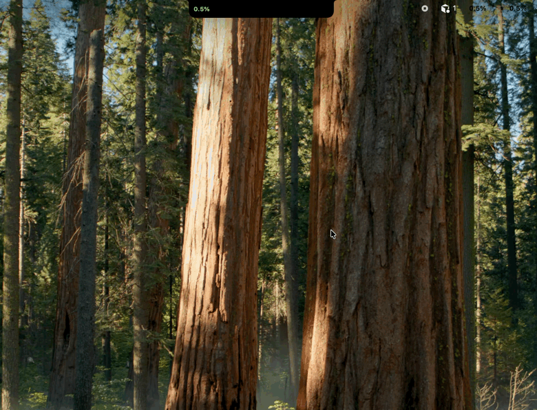
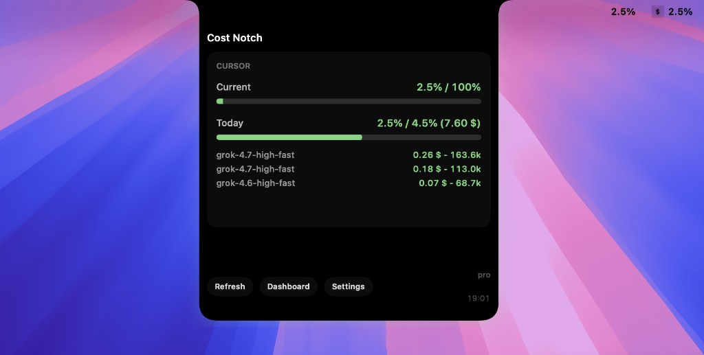
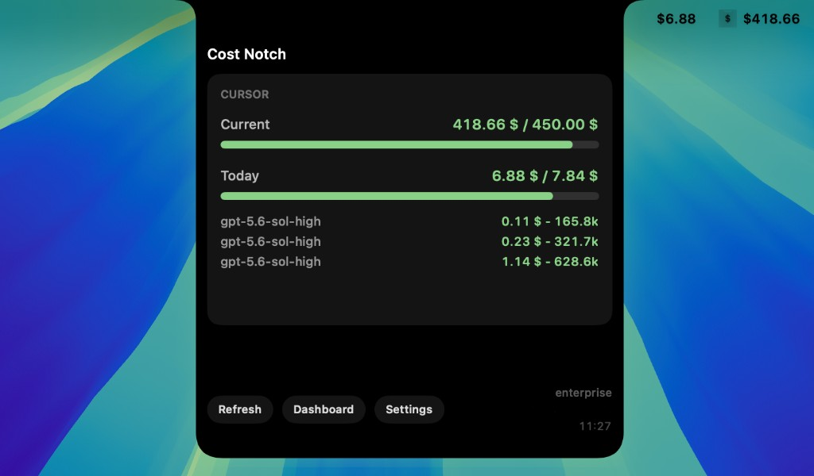

# Cost Notch

[](https://github.com/remnov/cost-notch/actions/workflows/ci.yml)
[](https://github.com/remnov/cost-notch/releases)
[](https://github.com/remnov/cost-notch/releases)
[](https://github.com/remnov/cost-notch/releases)

macOS menu-bar and notch overlay for Cursor and Codex spend. Choose the provider in Settings. Hover the camera notch on the Mac display to expand Current, Today, and recent queries (Cursor) or 5-hour and weekly rate limits (Codex). The overlay stays on that screen and does not appear on other monitors.

Supports Intel-based Macs and Apple Silicon (M-series). The current release is an Intel (`x86_64`) binary: native on Intel Macs, and on Apple Silicon through Rosetta.

Not an official Cursor product.

## Demo

Menu bar, notch, and Settings.



[menu-bar.mov](docs/media/menu-bar.mov)

## Pro and Enterprise

On a Pro plan, Current is the percent of included usage. Today is the percent of the daily budget, with the dollar amount beside it.



On an Enterprise plan, Current and Today are dollar amounts against the cap.



## Install

Download the latest **.dmg** or **.pkg** from [Releases](https://github.com/remnov/cost-notch/releases).

Unsigned/ad-hoc builds: first launch → System Settings → Privacy & Security → Open Anyway.

Signed + notarized builds (Apple Team ID): see **[RELEASE.md](RELEASE.md)**.

## Features

- Collapsed notch chip with compact Current spend
- Expanded provider card: Current / Today progress bars for Cursor, 5-hour / Weekly for Codex (green under cap, red over)
- Recent queries (Cursor), Refresh, Dashboard, Settings
- Menu-bar chips (works in Agent view and on external displays)
- Reads the local Cursor session or `~/.codex/auth.json`; no extra login

## Build from source

Requires macOS 13+ and Xcode Command Line Tools / Xcode.

```bash
swift test
./build-app.sh
open "artifacts/Cost Notch.app"
```

Installers:

```bash
./package.sh
```

Writes `dist/Cost-Notch-1.2.0.dmg` and `dist/Cost-Notch-1.2.0.pkg` (or `artifacts/` if `dist/` is not writable).

Architecture and overlay rules: [`AGENTS.md`](AGENTS.md).

The app is a menu extra (no Dock icon). Quit from the menu-bar item. Sign in to Cursor on this Mac, then choose **Refresh** in Cost Notch. For Codex, run `codex login`, choose **Codex** in Settings, then Refresh. For encrypted Cursor sessions, macOS may ask permission to read **Cursor Safe Storage** in your Keychain. Allow access to load usage. The encryption password is cached only for the running app, so allowing access once is sufficient until restart. Background refresh never opens permission prompts; choose **Refresh** again if access was denied or the Keychain was locked.

If a refresh fails after usage has loaded, the app keeps the last figures, marks compact values with `*`, and shows **Stale** with the error. These figures remain available until a successful refresh or app restart. Unsupported encryption formats ask you to update Cost Notch instead of asking you to sign in again.

## Privacy

- Reads `~/Library/Application Support/Cursor/User/globalStorage/state.vscdb` (session tokens and account email, read-only)
- Supports legacy plaintext tokens and Cursor's `cursor-safe-storage:v1:` / Electron `v10` encrypted tokens using the **Cursor Safe Storage** / **Cursor Key** Keychain item
- Keeps decrypted credentials in memory; never writes them back to Cursor's database, Codex `auth.json`, or app preferences
- Calls `https://cursor.com/api/usage-summary` and `https://cursor.com/api/dashboard/get-filtered-usage-events`
- When Codex is selected, reads `~/.codex/auth.json` (or `$CODEX_HOME/auth.json`) and calls `https://chatgpt.com/backend-api/wham/usage`
- Treat totals as an overlay, not an invoice

Cursor is a trademark of Anysphere. This project is not affiliated with Cursor or Anysphere.
