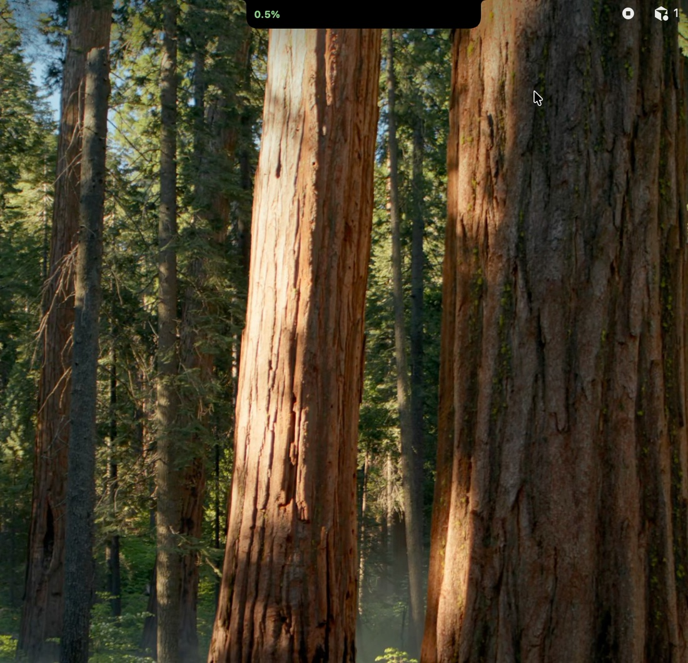
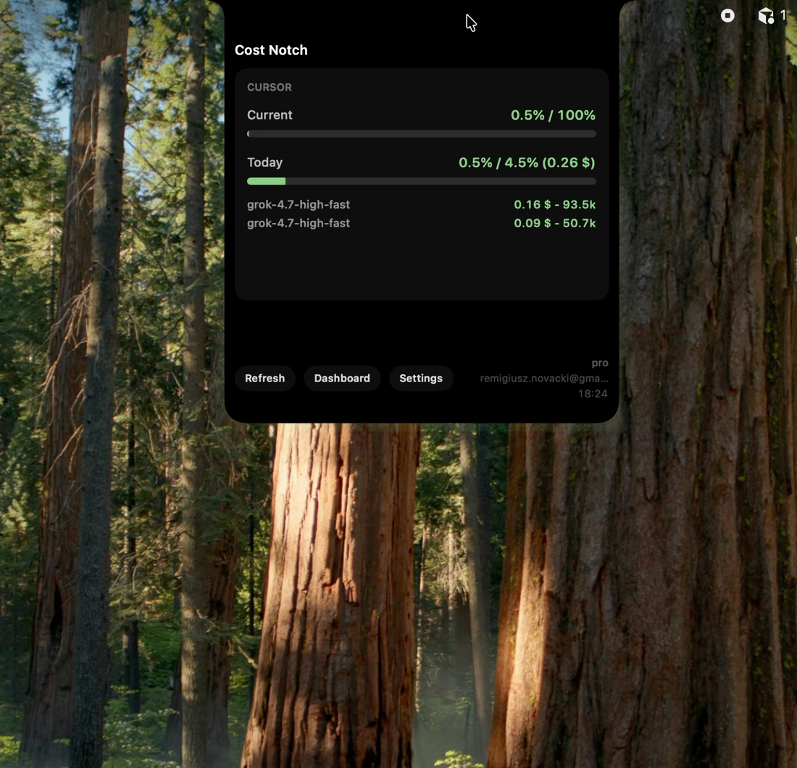
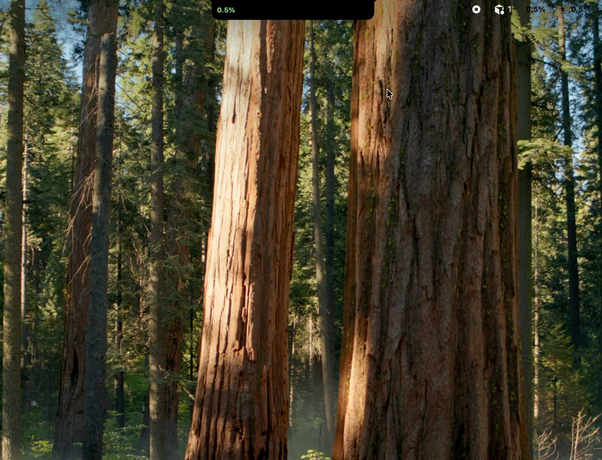
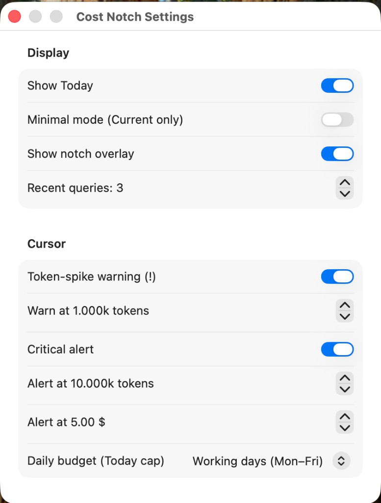
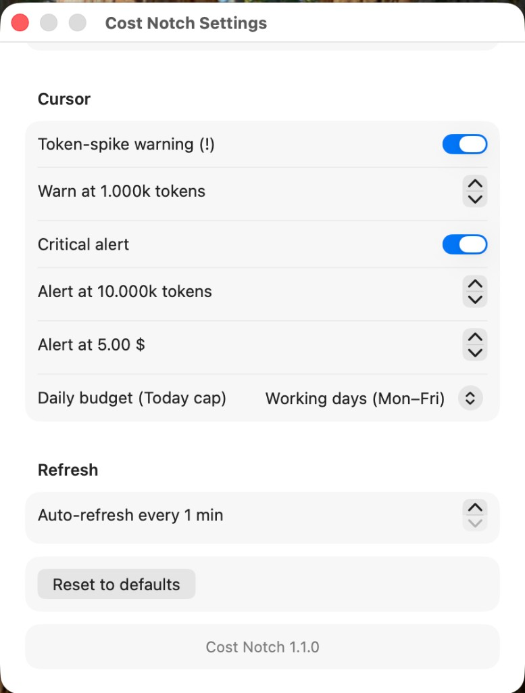

# Cost Notch

[](https://github.com/remnov/cost-notch/actions/workflows/ci.yml)
[](LICENSE)
[](https://github.com/remnov/cost-notch/releases)

macOS menu-bar and notch overlay for Cursor spend. Hover the camera notch (or the top edge of any display) to expand Current, Today, and recent queries.

Not an official Cursor product.

## Demo

Overlay: collapsed pill, expanded Cursor card, then Settings.


[overlay.mov](docs/media/overlay.mov)

Menu bar: Current and Today chips beside the notch.


[menu-bar.mov](docs/media/menu-bar.mov)

### Screenshots











## Install

Download the latest **.dmg** or **.pkg** from [Releases](https://github.com/remnov/cost-notch/releases).

Unsigned/ad-hoc builds: first launch → System Settings → Privacy & Security → Open Anyway.

Signed + notarized builds (Apple Team ID): see **[RELEASE.md](RELEASE.md)**.

## Features

- Collapsed notch chip with compact Current spend
- Expanded Cursor card: Current / Today progress bars (green under cap, red over)
- Recent queries, Refresh, Dashboard, Settings
- Menu-bar chips (works in Agent view and on external displays)
- Reads the local Cursor session; no extra login

## Build from source

Requires macOS 13+ and Xcode Command Line Tools / Xcode.

```bash
swift test
./build-app.sh
open "artifacts/Cost Notch.app"
```

Installers:

```bash
./package.sh
```

Writes `dist/Cost-Notch-1.1.0.dmg` and `dist/Cost-Notch-1.1.0.pkg` (or `artifacts/` if `dist/` is not writable).

Architecture and overlay rules: [`AGENTS.md`](AGENTS.md).

The app is a menu extra (no Dock icon). Quit from the menu-bar item. If spend shows **N/A**, sign in to Cursor on this Mac and choose **Refresh**.

## Privacy

- Reads `~/Library/Application Support/Cursor/User/globalStorage/state.vscdb` (session token only, read-only)
- Calls `https://cursor.com/api/usage-summary` and `https://cursor.com/api/dashboard/get-filtered-usage-events`
- Treat totals as an overlay, not an invoice

## License

[MIT](LICENSE) © 2026 Remigiusz Nowacki

Cursor is a trademark of Anysphere. This project is not affiliated with Cursor or Anysphere.
